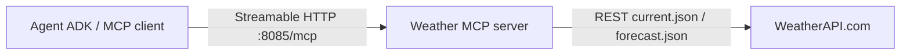

# Weather MCP server

Python ≥ 3.12, MCP SDK 2.3.0. Ba tools: `get_current_weather`, `get_forecast` và `health_check`.

## Bước 4 — dựng server cho agent



`WEATHERAPI_KEY` chỉ đặt ở server. Agent khám phá tool qua MCP, không cần biết key hoặc REST endpoint của WeatherAPI.

Từ gốc repo:

```bash
uv sync --locked --project 04-lab/mcp-server --python 3.12
uv run --project 04-lab/mcp-server python 04-lab/mcp-server/weather.py --transport streamable-http
```

Tạo `.env` trong thư mục này từ [.env.example](.env.example), điền `WEATHERAPI_KEY`. Health chỉ xác nhận MCP ready và key có được cấu hình không; current/forecast mới gọi provider. City không rỗng, tối đa 200 ký tự; forecast nhận đúng 1–3 ngày. Provider/validation lỗi trả MCP tool error, không giả dữ liệu thành công.

PowerShell, từ gốc repo; giữ nguyên file env đã có:

```powershell
if (!(Test-Path 04-lab/mcp-server/.env)) { Copy-Item 04-lab/mcp-server/.env.example 04-lab/mcp-server/.env }
uv sync --locked --project 04-lab/mcp-server --python 3.12
uv run --project 04-lab/mcp-server python 04-lab/mcp-server/weather.py --transport streamable-http
```

Linux/macOS dùng `test -f 04-lab/mcp-server/.env || cp 04-lab/mcp-server/.env.example 04-lab/mcp-server/.env` rồi chạy hai lệnh uv tương tự. Điền key trong file env trước khi khởi động; không dán key vào README hoặc ảnh.

## Đối chiếu với codelab

Transport được chọn bằng `--transport`, mặc định HTTP ở loopback, port 8085. Dùng `--transport stdio` nếu client tự khởi chạy process; logs chỉ ở stderr. HTTP là stateless JSON. Env được đọc theo đường dẫn file; shell env được ưu tiên.

| Nội dung starter/codelab | Bản repo hiện tại |
|---|---|
| FastMCP / tự chọn HTTP theo PORT hoặc `stdin.isatty()` | MCP SDK v2 `MCPServer`; HTTP mặc định, chọn transport bằng CLI. Chạy nền vẫn là HTTP |
| Bind `0.0.0.0:8085` | Local bind `127.0.0.1:8085`; chỉ dùng `--host 0.0.0.0` khi cần phục vụ ngoài loopback |
| Ba dòng print có biểu tượng | Logging `Starting weather MCP: transport=streamable-http` và log Uvicorn; không có ba dòng print nguyên mẫu |
| Thiếu key trả chuỗi thông báo | Current/forecast trả MCP tool error; health báo `weather_api_configured=false` |
| Health trả chuỗi | Health trả object `status`, `weather_api_configured`, `weather_api_verified`; không gọi WeatherAPI |

Readiness được kiểm tra bằng MCP initialize → list_tools → health, không chỉ dựa vào dòng log hoặc GET thành công. Tool trả lỗi thiếu key là vấn đề cấu hình server; key YesScale ở client không thay được WeatherAPI key.

## Checkpoint và evidence

Mở terminal thứ hai từ gốc repo, trong khi server vẫn chạy:

```powershell
uv run --project 04-lab/mcp-client python 04-lab/mcp-client/verify_setup.py --server-url http://127.0.0.1:8085/mcp --output reports/evidence/step04_server_readiness.json
```

Lệnh trên không gọi LLM/WeatherAPI. `mcp_protocol` và `adk_discovery` phải passed, đủ ba tools, health status ok và key configured true. `weather_api_verified=false` ở health chỉ nói health không xác minh API; evidence API thật nằm riêng trong [live_setup.json](../../reports/evidence/live_setup.json).

Lần kiểm tra hiện hành: [step04_server_readiness.json](../../reports/evidence/step04_server_readiness.json), [stdout](../../reports/evidence/step04_server_readiness.txt). Đã sync theo lockfile và pip check đạt; server ở 8085 được giữ chạy cho bước 5. Current/forecast thật đã có trong batch live trước đó, không chạy lại API để thay bằng số mới trong checkpoint readiness.

Nếu đổi cổng, dùng `--port 8086` hoặc đặt `PORT=8086` ở server; sửa `MCP_SERVER_URL=http://127.0.0.1:8086/mcp` trong env client rồi khởi động lại client. Nếu cổng đang có đúng server này thì dùng tiếp; nếu là dịch vụ khác, chọn cổng trống. Không chạy hai server trên cùng cổng.

Chưa cần thêm ảnh ở bước 4; bước 5 dùng output verify_setup và phiên agent làm evidence. Giữ terminal server chạy, dừng bằng Ctrl+C khi xong phiên thực hành.

## Docker và kiểm tra bổ sung

Dockerfile dùng port container 8080 hoặc `PORT` do nền tảng cấp, bind `0.0.0.0`. Env/key bị loại khỏi build context bởi `.dockerignore`. [Image local đã build](../../reports/evidence/container_preparation.json), chưa kiểm tra runtime container. Cloud Run là tùy chọn và được bỏ qua theo yêu cầu; không xem Docker build là evidence deployment.

Kiểm tra từ gốc repo bằng `uv run --project 04-lab/mcp-client python scripts/check_lab.py`; thêm `--live-weather` để gọi provider và `--live-agent` để kiểm tra LLM + MCP. Xem [lab README](../README.md).
